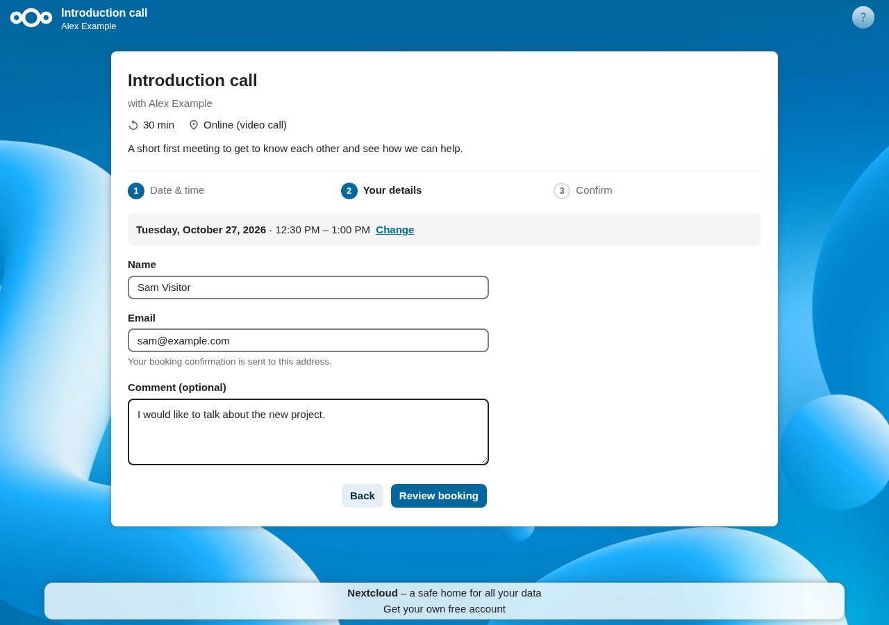
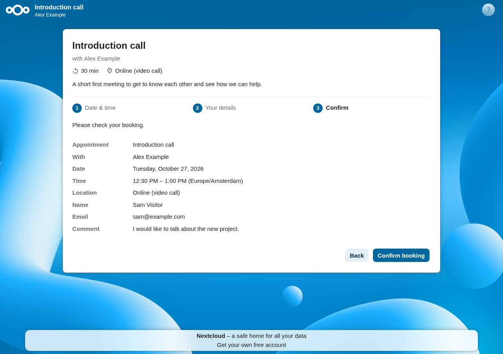
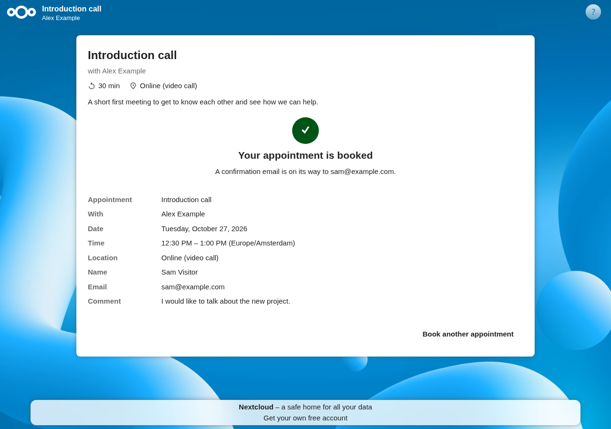
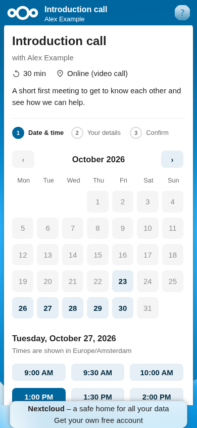

# Quick Booking

A Nextcloud app that adds a one-page booking flow for the appointment schedules
of the Calendar app:

**pick date & time → enter details → review & confirm → booked → confirmation email**

The visitor does not have to confirm by email first. The Calendar app itself still
writes the event, creates the Talk room (if configured) and sends the booking
emails with the `.ics` attachment, so everything else behaves like a normal
Calendar appointment.

Nextcloud and the Calendar app are not modified.

## Screenshots


| Your details | Review & confirm |
| --- | --- |
|  |  |

| Booked | On a phone |
| --- | --- |
|  |  |

## Features

- **Share the usual Calendar link**: the Calendar's own booking link
  (`https://<cloud>/apps/calendar/appointment/<token>`, "Copy link" in the Calendar
  app) opens the Quick Booking page. When Quick Booking is switched off, disabled
  or removed, the same link shows the Calendar's own booking page, so a shared
  link never breaks. To always get the Calendar's own page (with email
  confirmation), add `?qb=fallback` to the link.
  The Quick Booking page itself is `https://<cloud>/apps/quickbook/book/<token>`;
  don't share that one, it gives a 404 when the app is not installed.
- **Minimum notice**: use the Calendar's own "Minimum time before next slot"
  setting of the schedule; Quick Booking follows it.
- **Rate limit**: 5 bookings per visitor per hour (Nextcloud's built-in rate
  limiter). Change it in `config.php` without touching the code:
  ```php
  'ratelimit_overwrite' => [
      'quickbook.bookingapi.book' => [
          'anon' => ['limit' => 5, 'period' => 3600],
          'user' => ['limit' => 5, 'period' => 3600],
      ],
  ],
  ```
- **Limit per email address**: at most 3 bookings per email address per 24 hours,
  wherever they come from (also through Nextcloud's rate limiter). This stops
  someone with many IP addresses from flooding a stranger with booking emails.
  Change it with `occ config:app:set quickbook email_limit --value=5 --type=integer`
  and `email_period` (seconds); `0` switches it off.
- **Clean names**: invisible characters (bidi overrides, zero-width characters) are
  removed from names and comments, and names with `@`, `<` or `>` are refused, so a
  booking cannot look like a different name or email address in the organizer's mail.
- **Self-check** (see below).

## Self-check: what happens when the Calendar app or Nextcloud changes

Quick Booking uses internal (non-public) code of the Calendar app. It does not
switch itself off just because a version changed; it switches off only when
it sees that something is broken. The maximum Nextcloud version in `info.xml`
(required by the App Store) is set generously for the same reason: within that
range, the self-check decides.

| When | What is checked |
| --- | --- |
| First request after a Calendar, Nextcloud or Quick Booking update | Quick check: all Calendar classes, methods, parameters and fields used still exist |
| Background job, daily and within 15 minutes after updates | Full check: Quick Booking's own parts load on this Nextcloud version, quick check, Calendar services load, real slot lookup on an existing schedule, test booking stored and removed |
| Every real booking | On an unexpected error (missing method, wrong type, unexpected return value) the quick check runs again. If it fails, the Calendar code changed: off. If it passes, the error may have come from that visitor's request, so it only switches off when bookings from 3 different networks fail within an hour. |

When something breaks:

- shared booking links show the **standard Calendar booking page** (with email
  confirmation), and visitors already on the Quick Booking page are sent there,
  so bookings keep working;
- admins get a Nextcloud notification, and the reason is shown under
  Settings → Administration → Quick Booking;
- while it is off, the full check repeats every 15 minutes. If the self-check
  found the problem, Quick Booking switches back on as soon as the check passes.
  If it was switched off because bookings from several networks failed (while the
  check passed), it waits for an update or for an admin to run the check
  manually (button in the admin settings, or `occ quickbook:check`).

Ordinary failures (slot just taken, a database hiccup) never switch anything off.
Requests are validated before they reach the Calendar code (exact appointment
length, start between now and the booking horizon, named timezones only), so a
single visitor cannot switch Quick Booking off.

## Install on your server

From the App Store: Apps → Organization → Quick Booking → Download and enable, then
continue with step 4.

By hand:

1. `make package` → `dist/quickbook-<version>.tar.gz` and its checksum file.
   Copy both to the server and run `sha256sum -c quickbook-<version>.tar.gz.sha256`;
   it must say `OK`.
2. Unpack it into your Nextcloud's `custom_apps/` folder (so you get `custom_apps/quickbook/`),
   owned by the web server user.
3. `occ app:enable quickbook`
4. `occ quickbook:check` to verify it works with your Calendar version.

5. **Check the visitor address (rate limit).** The booking limits count per IP
   address. If Nextcloud doesn't know your reverse proxy, every visitor gets the
   proxy's address and they all share one limit (5 bookings per hour for everyone).
   Open Settings → Administration → Quick Booking from outside your network, for
   example on a phone using mobile data: "Nextcloud sees your address as" must
   show the phone's public IP, not a `172.x`/`10.x`/`192.168.x` address.
   - Nextcloud AIO sets this up for its own built-in proxy. If you put another
     proxy in front of it (nginx, Caddy, Traefik, Cloudflare Tunnel, …), add that
     proxy's address to `trusted_proxies` and check again:
     `occ config:system:set trusted_proxies 0 --value=<proxy IP or range>`
     (on AIO: `docker exec --user www-data nextcloud-aio-nextcloud php occ …`).
   - Settings → Administration → Overview also warns about a wrong proxy setup.

Update: replace the folder and run `occ upgrade` if the version number changed.
Remove: `occ app:disable quickbook`; the Calendar's own booking page keeps working.

If Quick Booking itself fails on a new Nextcloud version in a way the checks miss,
its booking page sends visitors to the Calendar's booking page instead of showing
an error, and the Calendar link stops redirecting as soon as Quick Booking is off.

## Development

Requires Docker. Everything runs in containers; no PHP or Node on the host.

```sh
make dev     # Nextcloud 34.0.5 + Calendar + Mailpit, app mounted from ./quickbook
make lint    # PHP syntax check
```

### Release to the App Store

1. Bump `<version>` in `appinfo/info.xml` (and `max-version` when a new Nextcloud
   major is out and `occ quickbook:check` passes on it), commit.
2. `make release` (dev environment running): builds `dist/quickbook-<version>.tar.gz`
   from the committed code, code-signed with `occ integrity:sign-app`, plus
   `.sha256` and the archive signature `.sig`. Key and certificate are read from
   `~/.nextcloud/certificates/quickbook.{key,crt}`; never commit them.
3. `gh release create v<version> dist/quickbook-<version>.tar.gz dist/quickbook-<version>.tar.gz.sha256`
4. https://apps.nextcloud.com/developer/apps/releases/new: download URL of the
   `.tar.gz` asset from step 3, signature = contents of the `.sig` file.

- Nextcloud: http://localhost:8080 (user `admin`, password in `dev/.env`)
- Mailpit (all outgoing email): http://localhost:8025

The frontend is plain JavaScript and CSS (`js/`, `css/`), so there is no build step.

### Code map

- `lib/Calendar/CalendarBridge.php`: the **only** code that touches the Calendar app
- `lib/Calendar/ContractCheck.php`: the list of Calendar internals relied on
- `lib/Health/`: on/off state, full self-check, admin notifications
- `lib/Middleware/CalendarLinkMiddleware.php`: Calendar booking link → Quick Booking
- `lib/Service/BookingFlowService.php`: validation, limit per email address, per-schedule lock
- `js/booking.js`, `css/booking.css`: the public booking page
